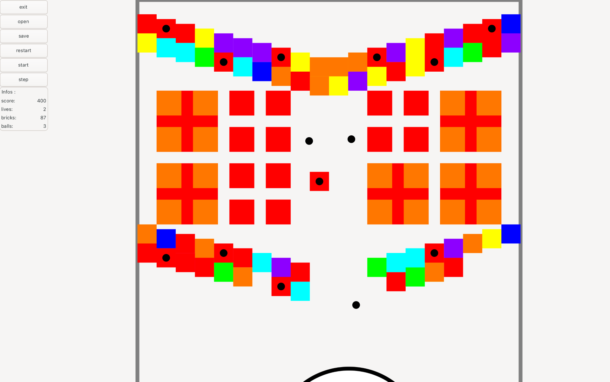

# Brick Game

A brick-breaker game in C++ with a gtkmm 4 interface, built for the Object-Oriented Programming course at EPFL by [@julius676](https://github.com/julius676) and [@Maurits33](https://github.com/Maurits33).



## Features

- Paddle controlled with the mouse
- Ball physics with collisions against the paddle, walls and bricks
- Polymorphic bricks: each brick type breaks in its own way
- Levels you pick from a menu

## Build and run

Requirements: g++ with C++17, pkg-config, gtkmm 4.

```bash
# Ubuntu / Debian
sudo apt install build-essential pkg-config libgtkmm-4.0-dev

# macOS (Homebrew)
brew install gtkmm4 pkg-config
```

```bash
cd Brick_Game
make
./project
```

## Controls

- Choose a level in the menu on the left (`test16.txt` is a good one).
- Press **S** to start.
- **Right-click** to spawn a new ball when you run out.
make
./project
```

Pick a level in the menu on the left (`test16.txt` is a good one), press **S** to start,
and **right-click** to spawn a new ball when you run out.

`make tests` opens the game on every level file in `tests/`, one after another.
`make clean` removes the build files.
